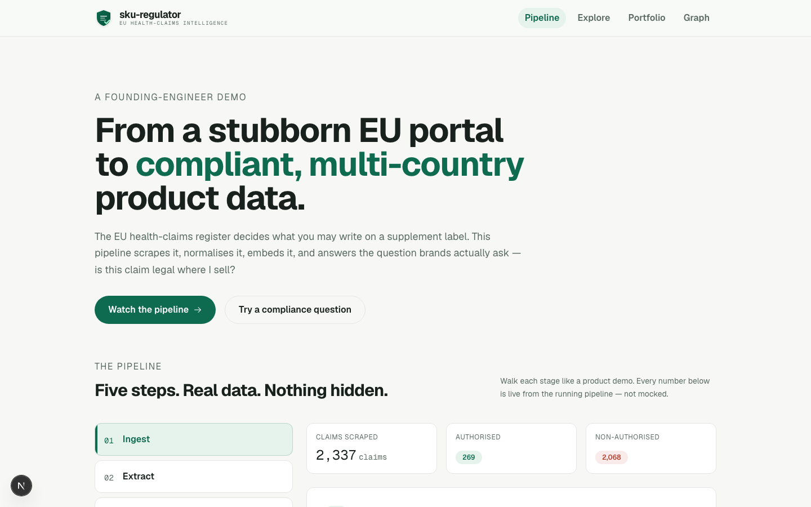
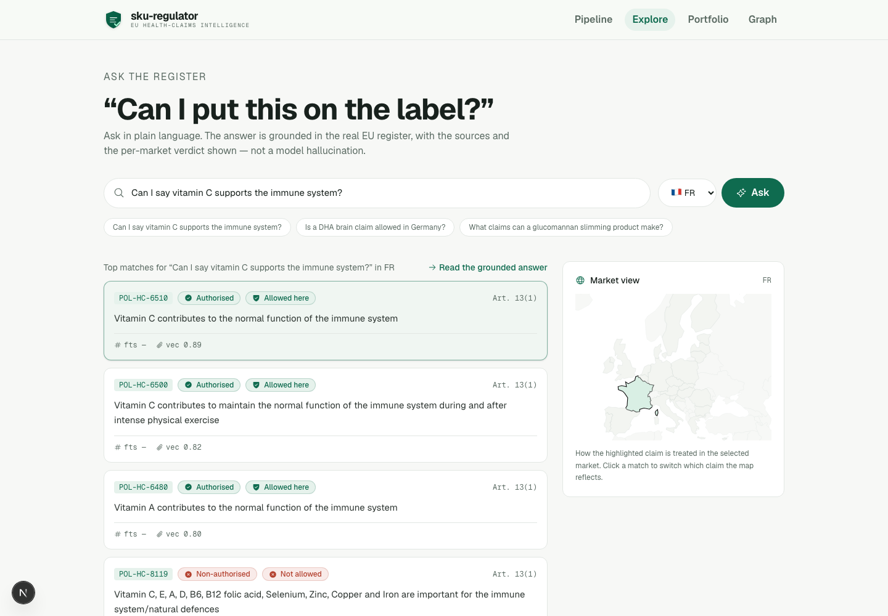

<div align="center">

# sku-regulator

**From a stubborn EU portal to compliant, multi-country product data.**

[](https://github.com/guillaume-flambard/sku-regulator/actions)
[](LICENSE)
[](https://www.python.org)
[](https://fastapi.tiangolo.com)
[](https://nextjs.org)
[](https://www.postgresql.org)
[](https://github.com/guillaume-flambard/sku-regulator/actions)

</div>

## Demo

Watch the **70-second demo video** generated by the repo itself (Playwright records
the UI, Remotion composes titles + captions, ffmpeg mixes the music — no screen
capture tool involved).

<div align="center">
  <a href="https://github.com/guillaume-flambard/sku-regulator/releases/download/demo-video-v1/sku-regulator-demo.mp4">
    
  </a>
</div>

<p align="center">
  <a href="https://github.com/guillaume-flambard/sku-regulator/releases/download/demo-video-v1/sku-regulator-demo.mp4"><strong>▶ Watch the demo video</strong></a>
  ·
  <a href="docs/architecture.md">Read the architecture take</a>
  ·
  <a href="docs/demo-runbook.md">Demo runbook</a>
</p>

---

## What this is

A founding-engineer build. It scrapes the **real EU Register of Nutrition &
Health Claims** (~2,300 claims), normalises it into a **Postgres + pgvector**
schema, and answers the question every health brand asks: *"is this claim legal
where I sell?"*

Every number in the UI is **live from the running pipeline**. Nothing mocked.

<div align="center">
  
</div>

## The pipeline

```
01 INGEST    02 EXTRACT       03 STORE                 04 RETRIEVE      05 VERIFY
scrape the   flatten a        multi-country            hybrid search    human-in-the-loop
stubborn     hostile          Postgres + pgvector      + grounded       compliance
portal       value-tree       (FTS + embeddings)       answer           queue
```

| Step | What happens | How |
|---|---|---|
| **01 Ingest** | Pull the register from `ec.europa.eu` — the same data the web UI renders. | Reverse-engineered the FIP backend API (`policy-items?foodDomain=nut&authorisationType=nut_auth`). Real browser User-Agent, crawl-friendly. |
| **02 Extract** | The register returns a recursive "value tree". Flatten each claim into a clean record. | Deterministic parser walks `valueIdentifier` nodes → `claims.jsonl` + best-effort ingredient extraction. |
| **03 Store** | A claim is authorised in one market, not another. Model that. | Postgres 16 + pgvector. Schema `products → skus → claims → ingredients → sources` + `country_status` pivot + 768-dim embeddings (local Ollama). HNSW index. |
| **04 Retrieve** | Compliance questions mix exact wording with intent. | Reciprocal-rank fusion over Postgres FTS **and** pgvector cosine similarity. Every hit carries the register code, EFSA opinion and per-country verdict. |
| **05 Verify** | Wrong data has consequences — so decisions are made by people. | Per-SKU compliance verdict + anomaly queue for low-confidence extractions and marketing-variant wording. |

## Repository layout

```
ingest/       fetch + parse the EU register (hostile portal)
store/        schema.sql, seed.py, demo_enrich.py
rag/          retrieve.py (hybrid FTS+vector), answer.py (LangChain + local LLM)
api/          FastAPI backend (stats, search, ask, anomalies, products)
web/          Next.js app + DESIGN.md (Stitch design system)
video/        standalone demo-video module (Playwright + Remotion + ffmpeg)
docs/         architecture, demo runbook, screenshots
```

## Run it

Prereqs: Docker, Python 3.11+, Node 20+, [Ollama](https://ollama.com)
(`nomic-embed-text` + `llama3.2:3b`).

```bash
bash scripts/demo.sh          # boot everything: db + seed + api + web
bash scripts/healthcheck.sh   # verify every layer before the demo
make demo-video               # generate the demo video
```

Open <http://localhost:3000>. **Pipeline** walks each step; **Explore** asks the
register in plain language; **Portfolio** shows SKU verdicts + the anomaly
queue; **Graph** renders products, claims and ingredients as a force graph.

## Tests & security

```bash
make test        # 73 Python tests + 20 Playwright E2E
make audit       # pip-audit + npm audit (0 known CVEs)
make lint        # ruff lint + format
```

- **RAG safety**: faithfulness (answers never invent statuses), prompt-injection
  resistance, strict output format.
- **Resilience**: clean JSON 500s when the DB is down; `/api/health` stays up.
- **Security**: parameterised SQL, no `innerHTML`, CORS locked to the local
  origin, security headers, `d3-color` ReDoS fixed via npm override.
- **CI**: 5 jobs on every push (unit, frontend, integration, e2e, video).

## Design system

`web/DESIGN.md` is the semantic design system used to generate all screens with
Google Stitch (mist background, sage accent, Geist + Geist Mono). Kept in sync
with the product and the video.

## Docs

- [`docs/architecture.md`](docs/architecture.md) — the 20-minute walkthrough
- [`docs/demo-runbook.md`](docs/demo-runbook.md) — the scripted demo flow
- [`docs/video-pipeline.md`](video/docs/video-pipeline.md) — how the video is made

---

*From the register to the label — compliance, end to end.*
