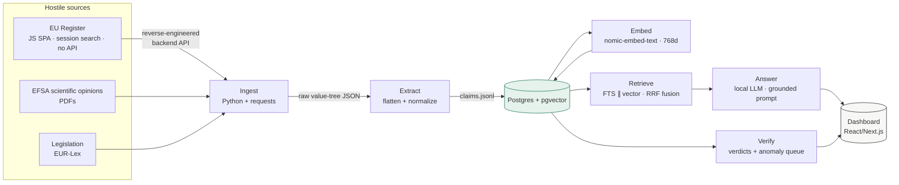

# Architecture — the 20-minute take

This document is the "how I would build a SKU-intelligence dashboard" walkthrough
that the Kensai application asks for. It explains the decisions behind
sku-regulator, in plain language, in the order a founding engineer would make them.

---

## The question, restated

A supplement brand wants to sell the *same product* in France, Germany and Spain.
Each market is governed by the same EU register, but compliance is decided claim
by claim, and the wording on the label must match the authorised wording. The
platform's job: **ingest the authoritative claim data, model it per market, and
answer "can my product say this here?" with proof.**

---

## The pipeline, in one picture



## Decision log (the reasoning a founder would care about)

### 1. Why scrape the portal instead of taking the official bulk export?

The register offers an Excel download. Taking it would be the *honest* shortcut,
and in production you probably would. But there are two reasons to build the
scraper anyway:

1. **The register is the canary.** It changes — new authorisations, revocations,
   reworded claims. If you can't detect and ingest changes, your data goes stale
   and you ship a non-compliant label. A scraper that re-fetches on a schedule is
   the *freshness engine*; the one-off export is a point-in-time snapshot.
2. **The same techniques generalise.** The hard part of this problem isn't this
   one portal — it's the next one (a national regulator, a retailer's
   requirement DB, a supplier's certification system). Building the
   "reverse-engineer a hostile source" muscle once pays for every source after.

### 2. Why Postgres + pgvector instead of a separate vector store?

The dataset is ~2,300 claims — thousands, not billions. A separate Elasticsearch
or a purpose-built vector DB adds an operator, a mapping layer, and a second
system to keep consistent, for zero benefit at this scale. Postgres already has:

- **full-text search** (`to_tsvector`, `ts_rank`) for exact regulatory wording;
- **pgvector** (`vector_cosine_ops`, HNSW) for semantic retrieval;
- **the relational shape** (products → claims → countries) the product needs
  anyway.

One database, one backup, one migration path. When the vocabulary and volume
outgrow it (hundreds of thousands of SKUs, multi-language), the retriever is a
thin layer — swap the vector store behind the same interface.

### 3. Why hybrid retrieval (FTS ∥ vector)?

These two failure modes are the actual product:

- **Exact wording matters.** The condition *"the claim may be used only for food
  which contains 1 g of glucomannan per quantified portion"* is legally binding.
  Full-text search finds it.
- **Intent matters.** A brand asks *"can I say this boosts immunity?"* — the
  register words it as *"contributes to the normal function of the immune
  system."* Semantic search bridges the gap.

Reciprocal-rank fusion combines both lists so a claim that matches either stays
visible. This is the difference between "found the string" and "answered the
question".

### 4. Why the multi-country pivot table?

A claim is authorised at EU level, but the *product* is sold per market. The
`country_status` pivot answers the compliance question directly:

```
claim_id | country | status
---------+---------+---------
  6510   |   FR    | allowed
  6510   |   DE    | allowed
  6510   |   GB    | allowed      (EU-derived rules retained post-Brexit)
```

Same product, same claim, different markets → one lookup. The schema also leaves
room for the *other* dimension regulators care about: not just "can you say it"
but "can you say it *with this restriction*".

### 5. Why human-in-the-loop for verification?

Regulated data has a different error budget than a search index. A hallucinated
claim on a label is not a bad search result — it's a recall, a fine, a health
risk. So the pipeline is honest about its own confidence:

- extraction confidence per field (OCR + LLM forced-JSON);
- a **verdict** per product-claim link (`compliant` / `non_compliant` / `review`);
- an **anomaly queue** for low-confidence or marketing-variant wording.

The system gets the data 95% of the way there and *shows its work* for the last
5%. A person decides what a model must not.

### 6. Why local AI (Ollama)?

Two reasons. First, embeddings of regulatory text are not a differentiator —
`nomic-embed-text` at 768-dim is good enough, runs on this machine, and keeps
regulated data where it belongs. Second, the demo should not depend on an API
key to exist. The LLM is swappable: the retriever is framework-agnostic SQL, and
the answer layer is one prompt away from a hosted model when scale demands it.

---

## The schema (DDL summary)

```
countries            ISO-3166 codes + market flag
ingredients          canonical substance names
claims               one row per EU claim + embedding vector(768)
claim_ingredients    claim ↔ substance join
sources              provenance (register / EFSA / legislation) + fetched_at
country_status       claim × market verdict
products             SKUs + market of sale
product_claims       SKU ↔ claim with verdict + confidence
anomalies            human-in-the-loop queue
```

## What's deliberately NOT here

- **No Elasticsearch / vector DB service** — Postgres covers it (see #2).
- **No hardcoded per-country claim data** — the register is the single source
  of truth; markets are derived, not duplicated.
- **No mocked numbers** — every figure in the demo comes from the live DB.
