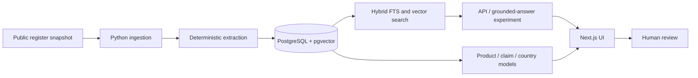

# sku-regulator — full-stack engineering case study

**Problem:** help product teams inspect and trace health-claim records from a public EU source before human review.

[Main README](../README.md) · [70-second recorded demo](https://github.com/guillaume-flambard/sku-regulator/releases/download/demo-video-v1/sku-regulator-demo.mp4) · [Architecture](architecture.md) · [Demo runbook](demo-runbook.md)

## Product journey

1. **Ingest:** fetch and parse the public EU nutrition/health-claims register into a controlled dataset.
2. **Normalize:** map nested records to stable IDs, source references and a relational structure.
3. **Search:** combine exact wording retrieval with embeddings for exploratory natural-language questions.
4. **Inspect:** compare retrieved passages, product-claim relationships and country-specific *modelled* status.
5. **Review:** flag uncertain extraction and wording for human decision-making.



## Technical choices

| Need | Implementation | Trade-off |
| --- | --- | --- |
| Nested data import | Python parser and JSONL intermediate format | Scraped/unofficial endpoints can change; import needs monitoring |
| Exact terms and semantic questions | PostgreSQL full-text search plus pgvector/HNSW | Semantic matches can be relevant without being legally admissible |
| API boundary | FastAPI for stats, search, responses and review | Requires explicit failure handling and source provenance |
| Web product | Next.js with separate explore, portfolio and graph flows | A polished UI can look more authoritative than the underlying evidence |
| Decision support | Anomaly queue and human review | An unchecked status must not automatically become product-label approval |
| Reproducible demonstration | Playwright + Remotion and release video | Scripted demonstration is not an external-user usability study |

## Reproduce the implementation checks

The full demo requires **Docker, Python 3.11+, Node.js and local Ollama models**. The model dependency is computationally substantial; avoid launching it on resource-constrained machines without capacity planning. A working build does not ensure today's public EU source still behaves like the recorded snapshot.

```sh
bash scripts/demo.sh
bash scripts/healthcheck.sh
make test
make lint
make audit
```

See [demo runbook](demo-runbook.md). Inspect each command before running against a machine with existing services or databases.

CI separates Python unit tests, frontend checks, PostgreSQL integration checks, an API + UI E2E suite, and video-module typechecking. Check the [current CI run](https://github.com/guillaume-flambard/sku-regulator/actions) on the relevant commit rather than assuming an old successful run applies.

## What the video demonstrates

The published `demo-video-v1` asset shows a scripted 1080p application journey. Scenes include the ingest overview, an interactive retrieval question with source-linked results, the product-claim review UI and a relationship graph. Its recorded values describe that **specific dataset and point in time**.

It does **not** establish that a model answer correctly interprets current regulations, that every EU/national condition of use is represented, that customer data is production-safe, or that real customers adopted the tool.

## Pre-commercial acceptance gates

- [ ] Verify ingestion freshness, provenance, effective date and source terms directly against today's official public registers.
- [ ] Independently adjudicate a representative corpus with regulatory domain experts, including prohibitions, conditions of use and wording variants.
- [ ] Test the full UI as a new external user with both valid and misleading AI responses.
- [ ] Document human-review authority, audit trail, data retention and privacy boundaries.
- [ ] Confirm full security testing, deployment environment and incident handling.
- [ ] Validate that labels, colors and copy cannot be misconstrued as automatic legal approval.

**Scope:** a working engineering demonstration. It is not legal advice, a medical recommendation or a compliance certificate.
